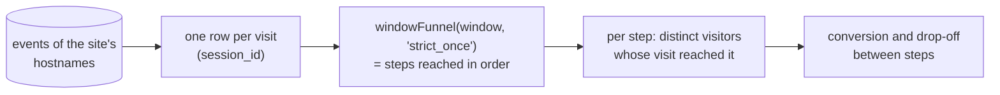

# Funnels

A funnel is an ordered list of 2 to 8 steps that a visit can go through: say, a blog post, then the pricing page, then a signup. For a range of days, the funnel report counts the visitors who reached each step, the share of them who went on to the next one, and how many dropped off between two steps. It can be broken down and filtered by where the visits came from and by their campaign.

Funnels are defined per site under **Funnels** in the site's menu, or through the [API](api.md#funnels). Members of the organization see them; owners and admins create, edit and delete them, as with goals.

## Steps

Each step is one of:

| Step | Completed by |
|------|--------------|
| **Page** | A pageview whose path matches the pattern. A pattern without `*` is an exact path (`/pricing`). In a pattern, `*` stands for any run of characters, `/` included, and every other character is itself: `/blog/*` matches `/blog/` and `/blog/2026/funnels`, not `/blog`; `/docs/*/install` matches `/docs/linux/install`. A pattern starts with `/` or `*`. Paths are stored without their query string, so a pattern never sees one. |
| **Goal** | A completion of one of the site's [goals](use-cases.md#3-set-up-goals-and-track-conversions), counted as the stats count it: a custom event of the goal's name, or a pageview of the goal's page path. |

A step can carry a label, shown instead of the pattern or the goal's name. When a goal used by a funnel is deleted, its step can no longer be completed: the report shows it as "Deleted goal", with no visitors from there on, until the funnel is edited.

## How a funnel is counted

**The visit is the unit.** The events of each visit (one `session_id`; a visit ends after 30 minutes without an event) are read in time order by ClickHouse's [`windowFunnel`](https://clickhouse.com/docs/sql-reference/aggregate-functions/parametric-functions#windowfunnel) in its `'strict_once'` mode. A visit reaches step *n* when it completed steps 1 to *n* in that order:

- **In order.** A step counts only once the step before it was reached, in the same visit. Landing on `/pricing` and then reading a blog post does not reach the second step of *blog → pricing*.
- **Gaps allowed.** Other events between two steps do not matter: other pages, the engagement reports the tracker sends between pageviews, the pageview of the page a goal fires on.
- **One event, one step.** An event completes one step at most. In *`/blog/*` → `/blog/deep*`*, one pageview of `/blog/deep-dive` reaches the first step only; reading another blog page first, or a second deep page after it, reaches the second.
- **Within the visit.** The window is every day the query reads, so it never cuts a visit short: the visit is the only boundary. Steps spread over two visits do not add up.

**A visitor counts once per step**, however many of their visits reached it. A visitor is purestat's daily visitor hash, so the same person on two days is two visitors, as everywhere in purestat.

**A visit belongs to the day it started** (UTC), as visit metrics do in the [stats API](api.md#post-apiv1query). The report for one day counts the visits that started that day, including steps they completed after midnight.

**Source and campaign are the visit's own**: those of its first event, the landing. A signup three pages after a LinkedIn landing counts for `linkedin`. A visit still in progress counts too.

**Only the site's own hostnames count**: the site's domain, `www.` + the domain, and its allowed hostnames, as in every other report.

### Why `'strict_once'`

`windowFunnel` has several modes. They were compared on the same visits, with steps A → B → C, on ClickHouse 24.10.2 and 24.12.6:

| Visit | Reaches | default | `strict_order` | `strict_increase` | **`strict_once`** |
|-------|---------|---------|----------------|-------------------|-------------------|
| A, *other page*, B, C | 3 | 3 | 1 | 3 | **3** |
| A, C, B, C | 3 | 3 | 1 | 3 | **3** |
| one event that is both A and B, then C | 1 | 3 | 3 | 1 | **1** |
| A, then an event that is both A and B, then C | 3 | 3 | 3 | 1 | **3** |
| two events that are each both A and B | 2 | 2 | 2 | 1 | **2** |

- `'strict_order'` stops at the first event between two steps that is not the next step. Every pageview is followed by an engagement report, so no visit would get past its first step.
- The default mode lets one event complete two adjacent steps.
- `'strict_increase'` loses a step when one event matches two adjacent steps after a repeat of the first.

The integration tests (`crates/tests/src/funnel_test.rs`) pin each of these against a real ClickHouse.

## The report

For each step:

| Number | Meaning |
|--------|---------|
| Visitors | Distinct visitors whose visit reached the step |
| Conversion from the previous step | The share of the previous step's visitors who reached this one |
| Conversion from the first step | The share of the first step's visitors who reached this one |
| Drop-off | The previous step's visitors who did not reach this one |

A **breakdown** splits the report by one attribute of the visit: its channel (search, AI assistants, social and the rest), its source (`referrer_source`), its referrer's host, one of the five `utm_*` campaign parameters, or the campaign taxonomy's source and medium groups. Rows are ordered by the visitors at the first step, 10 by default and at most 100. **Filters** keep the visits whose attribute is, is not, contains or starts with a value. Both use the visit's own values, from its landing, read exactly as the dashboard and the [stats API](api.md#post-apiv1query) read them: a campaign source is normalised (`twitter` is `x`), and a channel comes from the referrer's host.

## Privacy

A funnel report is made of counts of visitors, as every purestat report is. It reads no IP address, no cookie, and nothing that links a visitor across days. The steps match page paths, which purestat stores without their query string or fragment.

## Requirements

ClickHouse **24.10 or newer**: older versions refuse the `'strict_once'` mode (24.8 does), and the report then answers `500`. The `clickhouse/clickhouse-server:24` image is 24.10.2.80, the version the tests run on. No table changes: funnels read the `events` table as it is.
