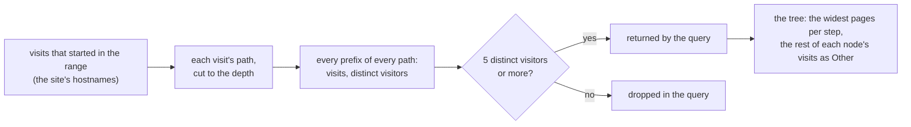

# Journeys

Journeys show the paths visitors take through a site, as a Sankey diagram, in two directions:

- **Next pages from an entry page**: of the visits that entered the site on a page, what they viewed next, and next after that, a few pages deep, and where they left.
- **Paths into a goal**: of the visits that completed one of the site's [goals](use-cases.md#3-set-up-goals-and-track-conversions), the pages that led up to it, the nearest first, back to where the visit started.

Open **Journeys** in the site's menu, or call the [API](api.md#journeys). Members of the organization can read them.

## What a path is

A path is a visit's pages in the order it viewed them, from pageview events only. A page reloaded, or opened again straight after itself, counts once, so `/a`, `/a`, `/b` is the path `/a` → `/b`; a page revisited later counts again. A visit is the run of events of one visitor with no 30-minute gap. It belongs to the day it started (UTC), as with [funnels](funnels.md); only the site's own hostnames count.

- **From an entry page**: the visits whose first page was the entry page. Their paths are the pages after it, up to the depth, then **Exit** when the visit ended within the depth.
- **Into a goal**: the visits that completed the goal, counted as the stats count goals: a custom event of the goal's name, or a pageview of the goal's page. Their paths are the pages before the first completion, nearest first, up to the depth, then **Entered** when the visit started within the depth. A pageview goal's own pageview is not a page before it, and nothing after the completion counts.

Every prefix of a path is a node: `/start` → `/a` → `/b` is three nodes under the anchor. The flows are **visits**, so a node's flow is the sum of the flows out of it.

## k-anonymity: fewer than 5 visitors fold into "Other"

A path followed by few visitors can identify one of them: someone who knows a visitor arrived from a link they sent can read where that person went. So a journey **never shows a path that fewer than 5 distinct visitors followed**:

- The rule is applied **in the ClickHouse query** (`HAVING visitors >= 5`), so a rarer path never leaves the database: not to the API, not to the browser. The threshold is not a request parameter.
- It counts **distinct visitors, not visits**: five visits by two visitors stay hidden.
- It applies to every node, the anchor included. When fewer than 5 visitors entered on the page, or completed the goal, there is no diagram at all, only a note that says so.
- What is not shown of a node's visits goes to one **Other** node under it: the visits that continued to pages fewer than 5 visitors reached, and those past the pages shown (below). **Other** names no page and ends its branch. An exit, or an entrance, is shown only when 5 visitors or more ended, or started, there; otherwise it is part of **Other** too.
- A visitor is purestat's daily visitor hash. The same person on two days is two visitors, so the rule means five visitor-days. Purestat cannot tell otherwise, by design.
- The rule holds for each report on its own: every path a report shows was followed by at least 5 visitors in that report's range.

## Bounds

A journey cannot grow without limit, whatever the site's traffic:

| Bound | Value |
|-------|-------|
| Depth: pages after the entry page, or before the goal | 1 to 5, default 3 |
| Width: pages shown per step, the most visited first | 1 to 10, default 5. Exits, entrances and **Other** come on top: at most one of each per page shown |
| Paths returned per step by the query | 100, the most visited |
| Range | at most 366 days |

So a diagram has at most 1 + (width + 2) + (depth − 1) × 3 × width nodes: 133 at the largest bounds, 38 with the defaults.

## Reading the diagram

The anchor (the entry page, or the goal) is the first column going forward and the last one into a goal. Each later column is one page further from it. Hover over a flow for its pages and visits. In a column, the pages come first, the most visited at the top, then the exit or entrance, then **Other**.

The diagram is drawn with [chartjs-chart-sankey](https://github.com/kurkle/chartjs-chart-sankey), a Sankey chart type for Chart.js, which the dashboard already uses.
